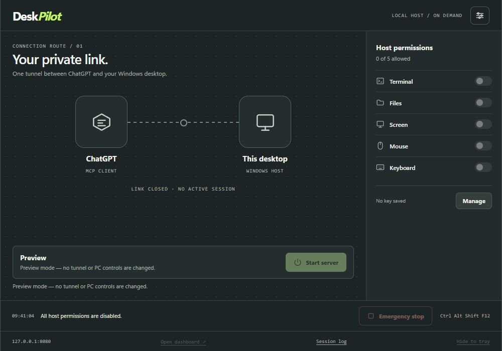
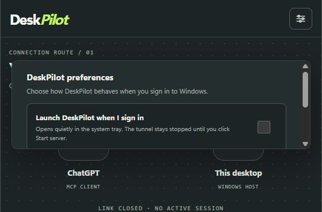
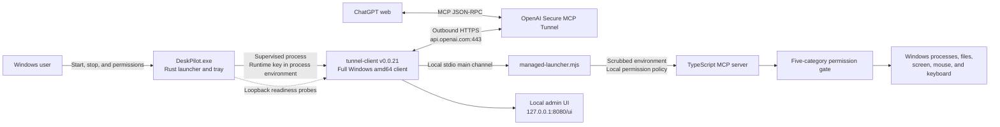

# DeskPilot

**Windows-first desktop control for ChatGPT, using the official OpenAI tunnel client.**

DeskPilot v1.0.0 is a source-first Windows MCP host. It lets a trusted ChatGPT session invoke explicitly enabled tools for terminal processes, files, screen capture, mouse input, and keyboard input on your desktop.

DeskPilot is derived from [Desktop Commander](https://github.com/wonderwhy-er/DesktopCommanderMCP). The upstream MIT license and attribution are retained in [LICENSE](LICENSE), [NOTICE](NOTICE), and [UPSTREAM.md](UPSTREAM.md).

> **Powerful local automation, not a sandbox.** DeskPilot runs with the rights of the signed-in Windows user. It does not provide an OS-level security boundary, and it cannot make an untrusted prompt safe. Run it as a standard user, keep permissions disabled until needed, and review actions before approving them.

## Contents

- [Features](#features)
- [Screenshots](#screenshots)
- [Requirements and service availability](#requirements-and-service-availability)
- [Architecture](#architecture)
- [Install on Windows](#install-on-windows)
- [Connect ChatGPT](#connect-chatgpt)
- [Configuration and permissions](#configuration-and-permissions)
- [Strict foreground-lease semantics](#strict-foreground-lease-semantics)
- [Official tunnel facts](#official-tunnel-facts)
- [Local dashboard](#local-dashboard)
- [Security model and limitations](#security-model-and-limitations)
- [Troubleshooting](#troubleshooting)
- [Uninstall](#uninstall)
- [Build from source](#build-from-source)
- [Attribution](#attribution)

## Features

- Native Rust launcher with a system-tray interface and an approved DeskPilot dashboard, wordmark, and DP monogram.
- MCP tools for terminal sessions, process management, file operations, search, document editing, windows, screenshots, mouse, and keyboard.
- Five local permission categories: **Terminal, Files, Screen, Mouse, and Keyboard**. All five are disabled on first launch.
- Deny-by-default file access. Enabling Files is not enough: every Files-category call is denied until at least one explicit workspace directory is configured.
- Strict, explicit foreground targeting for mouse and keyboard tools. Input tools never refocus a window or retry delivery automatically.
- Manual tunnel start and stop. Saving a key, opening DeskPilot, or enabling sign-in startup never starts the tunnel automatically.
- Optional Windows DPAPI storage for the runtime API key.
- A supervised official `tunnel-client` process. Exiting DeskPilot stops the process tree it launched through a Windows Job Object.
- Local activity metadata. Managed tool history is metadata-only in memory by default; detailed history and argument logging require explicit opt-in.
- Managed runtime settings that disable inherited upstream telemetry, remote feature-flag fetching, and feedback prompts.

## Screenshots

These captures show the actual approved dashboard HTML in preview mode with dummy state. No tunnel, credential, process, or private desktop data is shown.

| Dashboard with all permissions disabled | Opt-in Windows startup preference |
|---|---|
|  |  |

## Requirements and service availability

### Windows host

- Windows 10 or Windows 11, x64.
- An interactive, signed-in desktop session. DeskPilot's screen and input tools do not work in Session 0 or a non-interactive service.
- Microsoft WebView2 Runtime. The installer downloads and installs it automatically when missing; managed-device policy may require administrator approval.
- Outbound HTTPS access to the official OpenAI control plane and the download sources listed in [PRIVACY.md](PRIVACY.md).
- A standard Windows user account. Do not run DeskPilot as Administrator.

### ChatGPT availability

The following service facts were checked against official OpenAI documentation on **2026-11-25**. Availability and workspace policy can change.

| ChatGPT plan or surface | Documented custom MCP and tunnel availability |
|---|---|
| Business | Full custom MCP connections, including Secure MCP Tunnels, on ChatGPT web. Workspace admin controls apply. |
| Enterprise/Edu | Full custom MCP connections, including Secure MCP Tunnels, on ChatGPT web. Workspace roles, RBAC, and Lockdown apply. |
| Pro | Custom MCP connections with read/fetch permissions. The reviewed official sources do **not explicitly confirm tunnel eligibility**. |
| Free/Plus | Custom MCP tunnel availability is **not documented** in the reviewed official sources. |
| Mobile | Unsupported. Custom MCP connections are web-only. |

DeskPilot exposes write and desktop-control tools. A read/fetch-only account or workspace policy cannot provide the full DeskPilot workflow.

Workspace administrators control whether custom MCP connections can be created, published, and used. For Business, admins/owners create and publish custom apps. Enterprise/Edu administrators can use RBAC to grant creation and access. Lockdown and other workspace security restrictions still apply.

The reviewed official sources do not establish tunnel-specific pricing. Do not assume that an available plan or a downloadable client makes tunnel use free. Normal ChatGPT subscription or API usage charges are separate.

## Architecture



The tunnel transport needs no inbound firewall port. `tunnel-client` polls OpenAI over outbound HTTPS, forwards MCP requests to DeskPilot's local stdio server, and returns results through the same tunnel. OpenAI and the connected ChatGPT workspace are part of the data path; the tunnel does not make tool traffic private from them.

## Install on Windows

DeskPilot v1.0.0 is reviewed through a private source repository and draft GitHub Release. The approved artifacts are:

- `DeskPilot-v1.0.0-windows-x64.zip`
- `Install-DeskPilot-v1.0.0.ps1`
- `SHA256SUMS.txt`

For this draft, automatic GitHub Actions triggers are disabled. Validation is performed locally and manually, with evidence recorded in [docs/release-validation.md](docs/release-validation.md). No GitHub Actions pass is claimed for v1.0.0.

The installer uses the approved stable, non-draft `v1.0.0` assets after promotion within the private repository. Obtain the artifacts and expected checksums from the maintainer through the approved private channel. Do not use unofficial mirrors.

Before running the installer, compare both file hashes with `SHA256SUMS.txt`:

```powershell
Get-FileHash -LiteralPath .\DeskPilot-v1.0.0-windows-x64.zip, .\Install-DeskPilot-v1.0.0.ps1 -Algorithm SHA256
Get-Content -LiteralPath .\SHA256SUMS.txt
```

### Before installation

1. In [Platform tunnel settings](https://platform.openai.com/settings/organization/tunnels), create or reuse a tunnel and associate it with the intended Platform organization and ChatGPT workspace.
2. Copy the complete tunnel ID. DeskPilot v1.0.0 accepts the official format:

   ```text
   ^tunnel_(?:[a-z0-9]{4}_)?[a-z0-9]{32}$
   ```

3. In [Runtime API keys](https://platform.openai.com/settings/organization/api-keys), create a **Restricted** key with **Tunnels Read** and **Tunnels Use**. The key's principal must also hold those permissions for the target tunnel.
4. Do not create or paste an admin key for DeskPilot. An admin key is not needed to run the tunnel client.

### Run the installer

Download `Install-DeskPilot-v1.0.0.ps1` from the approved release and inspect it before running. From the folder containing the script:

```powershell
powershell -ExecutionPolicy Bypass -File .\Install-DeskPilot-v1.0.0.ps1
```

The installer:

- Downloads `DeskPilot-v1.0.0-windows-x64.zip` and verifies the archive against `SHA256SUMS.txt`. The release workflow also checksums `Install-DeskPilot-v1.0.0.ps1`; verify both files before running the installer.
- Downloads the Microsoft WebView2 bootstrapper from Microsoft's official fwlink when needed, verifies a valid Microsoft Corporation Authenticode signature, checks hash stability before execution, installs silently, and verifies the installation in the registry. A failure aborts before the DeskPilot application swap.
- Downloads portable Node.js **v24.22.3**, verifies its pinned SHA-256 checksum, and requires a valid OpenJS Foundation Authenticode signature.
- Downloads the full official `tunnel-client-v0.0.21-windows-amd64.zip` asset from `openai/tunnel-client` v0.0.21 and verifies it against the publisher's `SHA256SUMS.txt`. Runtime-only client archives are not substitutes for the full client.
- Creates `%LOCALAPPDATA%\DeskPilot\tunnel-client.yaml`. The profile references `CONTROL_PLANE_API_KEY`; it does not contain the key.
- Creates `permissions.txt` with all five categories disabled when no policy exists.
- Installs per-user under `%LOCALAPPDATA%\Programs\DeskPilot` and creates a desktop shortcut.

The normal installation is per-user. Release-asset access must be available to the installer, and WebView2 setup may require administrator approval under device policy. The installer does not launch DeskPilot by default; launching remains explicit opt-in with `-LaunchDeskPilot`.

After installation, open DeskPilot from the desktop shortcut and paste the restricted runtime key into the credential panel. Select **Remember on this Windows account with DPAPI** only if you want the key stored locally. Otherwise, supply it when you explicitly start the tunnel.

DeskPilot does not start the tunnel during installation. Click **Start server** only when you are ready to connect.

## Connect ChatGPT

1. Keep DeskPilot's tunnel client running by clicking **Start server**. Wait until the launcher reports that the tunnel is ready.
2. On ChatGPT web, open **Plugins**, select **Add custom MCP server**, and choose **Tunnel** as the connection type.
3. Select the associated tunnel or paste the complete tunnel ID.
4. Configure authentication as required by the approved workspace setup. DeskPilot's stdio MCP server does not add its own MCP login or bearer-token layer; tunnel access and ChatGPT workspace controls are the external access controls.
5. Review the risk warning, create the connection, and install the resulting plugin.
6. Start a conversation, select the plugin, and test a read-only action before enabling write or desktop-control categories.

ChatGPT can remember approval choices for a conversation. Review those choices carefully, especially for write actions. Workspace confirmation settings do not replace DeskPilot's local permissions.

If the tunnel is not listed, check the workspace association, plan eligibility, workspace roles/RBAC/Lockdown, and the operator's Tunnels Read + Use permissions. A newly assigned role can take up to 30 minutes to propagate.

## Configuration and permissions

### Five-category permission mask

| Category | Bit | What it enables |
|---|---:|---|
| Terminal | 1 | Start processes, interact with processes, read output, list sessions/processes, and terminate processes. Commands run as the signed-in Windows user. |
| Files | 2 | Read, write, search, list, move, and edit local files and supported documents within the configured workspace. |
| Screen | 4 | Capture the primary display and list visible top-level windows. |
| Mouse | 8 | Focus a window, move the pointer, click, and scroll. `focus_window` is required before input. |
| Keyboard | 16 | Type literal text and press named keys or shortcuts into an explicitly focused target. |

The mask is stored in `%LOCALAPPDATA%\DeskPilot\permissions.txt`. A fresh installation uses `0`. A missing, unreadable, or malformed policy fails closed.

Permissions are local guardrails, not proof that a requested action is safe. Changes apply when the server checks the policy for a tool call. Stop the tunnel before changing permissions if you need to ensure that no in-flight call can use the previous setting.

### File workspace

Files-category tools require a non-empty `allowedDirectories` list in:

```text
%LOCALAPPDATA%\DeskPilot\config.json
```

**With no workspace configured, every Files-category call is denied.** Add at least one explicit directory before enabling Files. Do not treat an empty list or a whole drive root as a safe default.

Exit DeskPilot before editing the file. Preserve the other settings and add a workspace with PowerShell, replacing the example path:

```powershell
$configPath = Join-Path $env:LOCALAPPDATA 'DeskPilot\config.json'
$config = if (Test-Path -LiteralPath $configPath) {
    Get-Content -LiteralPath $configPath -Raw | ConvertFrom-Json
} else {
    [pscustomobject]@{}
}
$config.allowedDirectories = @('C:\path\to\your\workspace')
$config | ConvertTo-Json -Depth 20 | Set-Content -LiteralPath $configPath -Encoding utf8
```

Configure workspaces locally, not through an untrusted model prompt. Remote MCP callers cannot change server configuration. DeskPilot's configuration/install trees and permission-policy file are denied to Files tools even if a workspace contains them. Server-side URL reads are disabled; download material into the workspace first.

Terminal commands can access files outside `allowedDirectories`; the workspace restricts Files-category tools, not the Windows account. The command blocklist is also advisory and is not a sandbox.

### Sign-in startup

Startup is opt-in in **Preferences → Launch DeskPilot when I sign in**. It adds a per-user Windows Run entry and opens DeskPilot quietly in the tray. The tunnel remains stopped until you explicitly start it.

Disable this preference before uninstalling if you no longer want the Windows Run entry.

### Runtime key and tunnel profile

The launcher passes `CONTROL_PLANE_API_KEY` only to the `tunnel-client` process environment. `managed-launcher.mjs` removes that variable and other tunnel/admin credential variables before starting the MCP server. The key is not written to `tunnel-client.yaml`.

DPAPI protects a saved key at rest for the current Windows account. It does not protect against malware running as that user, a compromised account, or an administrator. **Forget** removes the local copy; it does not revoke the key at OpenAI.

### Local state

DeskPilot stores state under `%LOCALAPPDATA%\DeskPilot`:

| Path | Purpose |
|---|---|
| `runtime-key.dpapi` | Optional DPAPI-protected runtime key. |
| `tunnel-client.yaml` | Tunnel ID and local stdio command; no API key. |
| `permissions.txt` | Five-category permission mask. |
| `activity.log` | Launcher status and lifecycle events. |
| `tool-history.jsonl` | Not written by default. `DESKPILOT_TOOL_HISTORY=1` opts into detailed local history with arguments and bounded result previews. |
| `deskpilot-tool-call.log` | Not written by default. `DESKPILOT_TOOL_CALL_LOG=1` opts into tool names and unredacted arguments; rotates at 10 MiB. |
| `config.json` | MCP server settings, including `allowedDirectories`. |
| `launch-on-sign-in.txt` | Saved startup preference. |
| `runtime/` | Portable Node.js v24.22.3 runtime and its license files. |
| `bin/` | Official tunnel-client v0.0.21 files and publisher notices. |

`config.json.corrupt.*` backups may also exist after configuration recovery. Managed sessions keep only recent tool metadata in memory by default: timestamp, tool name, duration, and outcome. They do not load or write detailed history, and they omit arguments and output. Desktop operations also omit typed text, coordinates, and screenshot data.

Detailed persistence is disabled unless the Windows owner explicitly sets `DESKPILOT_TOOL_HISTORY=1` or `DESKPILOT_TOOL_CALL_LOG=1` in the managed server environment. Those logs can contain command text, file paths, file content, and tool output. Treat all local state as sensitive.

## Strict foreground-lease semantics

Mouse and keyboard tools use a strict foreground lease:

1. Enable **Screen** to call `list_windows`, then choose the exact visible window handle and process ID. Enable **Mouse** before focusing or sending mouse input.
2. Call `focus_window` with that exact `window` and `pid`. Windows may deny the focus request; a failed focus call does not create a lease.
3. A successful focus call creates an in-memory lease for that exact window and PID. Every mouse or keyboard call must use the same pair.
4. Input tools verify that the target is still the foreground window before delivery. They **never call `SetForegroundWindow` and never retry input automatically**.
5. A failed focus or input operation, a changed target, or a restarted server invalidates the lease. Inspect the desktop, then explicitly call `focus_window` again before any manual retry.
6. Input is rejected while a physical modifier or mouse button is held.

There is a residual Windows race between the final foreground check and `SendInput` delivery. Another application or the user can change focus after the check, so input can still reach the wrong window. Windows also does not provide an atomic “send only to this HWND” input boundary in this implementation. A timeout, partial delivery, or uncertain result is not proof that nothing happened. Inspect the affected applications before retrying.

`capture_screen` and `list_windows` require **Screen**. They do not grant input access. Mouse and Keyboard do not implicitly grant each other or Screen.

## Official tunnel facts

These facts were checked against official OpenAI sources on **2026-11-25**:

- The full client asset is `tunnel-client-v0.0.21-windows-amd64.zip` from [tunnel-client v0.0.21](https://github.com/openai/tunnel-client/releases/tag/v0.0.21).
- Tunnel IDs use `^tunnel_(?:[a-z0-9]{4}_)?[a-z0-9]{32}$`.
- Running the client requires a restricted runtime key with **Tunnels Read + Use**. An admin key is not needed for `run`; tunnel creation/editing is a separate permission and workflow.
- Workspace roles, custom MCP app permissions, RBAC, and Lockdown apply. A new role assignment can take up to 30 minutes to propagate.
- The tunnel itself uses outbound HTTPS to `api.openai.com:443` under `/v1/tunnels/*`. It needs no inbound port. Other DeskPilot features, such as terminal commands, have their own network behavior. Server-side URL reads are disabled.
- Stdio bindings support only one active `tunnel-client` instance per tunnel ID. Multiple active clients sharing a stdio tunnel are unsupported.

| Service limit | Default |
|---|---|
| Tunnel count | 1,000 per ChatGPT workspace and 1,000 per Platform organization. Each associated tunnel counts toward both limits. |
| MCP request rate | 600 requests per minute, 10 per second sustained, shared by tunnel ID and calling application ID across channels. |
| Serialized request or response | 10 MiB (10,485,760 bytes) for the complete tunnel envelope, including headers and metadata. Applies to each streaming notification and final response. |
| Request deadline | 120 seconds from hosted queue admission through final response delivery. Queue time counts; progress notifications do not reset it. |
| Pending queue | 1,000 requests per tunnel, shared across channels. Already-fetched requests do not count as pending. |
| Active stdio client | One per tunnel ID. |

These are service protections, not throughput or latency guarantees.

### Local preflight

With `CONTROL_PLANE_API_KEY` set only in the current PowerShell process, run:

```powershell
& "$env:LOCALAPPDATA\DeskPilot\bin\tunnel-client.exe" doctor --profile-file "$env:LOCALAPPDATA\DeskPilot\tunnel-client.yaml" --explain
```

Do not paste the key into the YAML file or command arguments. Remove the environment variable when finished.

`doctor --profile-file <yaml> --explain` is a local preflight. It can validate the profile and report connection or authorization failures, but it is **not proof of ChatGPT authorization**. Plan eligibility, workspace association, app permissions, RBAC, Lockdown, and a successful live discovery/tool call must still be checked.

Official references:

- [Secure MCP Tunnel guide](https://developers.openai.com/api/docs/guides/secure-mcp-tunnels)
- [Custom MCP servers in ChatGPT](https://developers.openai.com/api/docs/guides/custom-mcp-server)
- [ChatGPT custom MCP availability and FAQ](https://help.openai.com/en/articles/12584461-connecting-custom-mcp-servers-in-chatgpt)
- [tunnel-client v0.0.21 permissions](https://github.com/openai/tunnel-client/blob/v0.0.21/docs/permissions.md)
- [tunnel-client v0.0.21 connector limits](https://github.com/openai/tunnel-client/blob/v0.0.21/docs/connectors.md#hosted-service-limits)

## Local dashboard

DeskPilot has two separate local interfaces:

- The native DeskPilot control window manages credentials, permissions, startup, and tunnel start/stop.
- The official tunnel-client admin dashboard is available at `http://127.0.0.1:8080/ui` while the client is running.

The tunnel-client dashboard is **loopback-only by default**. The reviewed v0.0.21 material describes limited `Origin`/`Referer` checks for browser actions, but does not document a built-in login or API-token authentication for the dashboard. Host-header validation and DNS-rebinding protection were **not confirmed**. Treat the dashboard as an unauthenticated local operator surface.

**Never enable remote UI, bind port 8080 to a non-loopback address, reverse-proxy it, or forward it to your LAN or the public internet.** Loopback reduces network exposure; it does not authenticate local processes or eliminate browser-based attacks.

## Security model and limitations

DeskPilot's controls reduce accidental exposure. They do not contain a malicious client, prompt injection, or a compromised Windows account.

- **No OS-level sandbox.** Terminal tools can launch arbitrary programs with the signed-in user's rights and can bypass file-workspace and command-blocklist restrictions.
- **Permissions are local policy, not user intent.** The server cannot determine whether a tool request came from a deliberate user action, injected content, or a compromised ChatGPT account.
- **File workspaces are not process isolation.** Files tools enforce configured path boundaries and protect DeskPilot runtime paths; terminal commands do not. Server-side URL reads and remote configuration changes are disabled.
- **Desktop input has a residual race.** Foreground checks reduce misdirected input but cannot make `SendInput` atomic or target-bound.
- **The dashboard is not an authenticated remote management plane.** Keep it on loopback and never expose it.
- **DPAPI is account-bound at-rest protection.** It does not protect secrets from same-user malware or an administrator.
- **The tunnel is a transport, not privacy from OpenAI.** Tool arguments, results, screenshots, and normal app-level logs can pass through or be retained by the connected services under their policies.
- **Process supervision is lifecycle control.** The Windows Job Object stops the launched tunnel process tree when DeskPilot exits; it is not a security sandbox.
- **v1.0.0 binaries are unsigned.** The private personal-account draft is checksummed but has no GitHub artifact attestation because GitHub Artifact Attestations require a public repository or GitHub Enterprise Cloud. Checksums are not Authenticode code signing or independent build provenance. See [PUBLISH.md](PUBLISH.md).

For hard isolation, use a separately managed virtual machine or dedicated workstation outside DeskPilot. DeskPilot does not create or claim that isolation.

See [SECURITY.md](SECURITY.md) for the full security policy and private reporting instructions, and [PRIVACY.md](PRIVACY.md) for local and network data handling.

## Troubleshooting

| Symptom | Checks and action |
|---|---|
| Installer cannot download a release or dependency | Confirm approved private-release access, DNS, proxy settings, and outbound HTTPS. Verify the expected asset and checksum. Do not bypass a checksum or signature failure. |
| WebView2 setup or initialization fails | The installer aborts before swapping the app if download, Microsoft signature verification, hash-stability, silent setup, or registry verification fails. Check the official fwlink, device policy, and administrator approval, then rerun the installer. |
| Port 8080 is already occupied | Stop the other tunnel client or local service using that port. DeskPilot refuses to treat an unrecognized listener as its dashboard. Do not expose the port. |
| Runtime key returns 403 | Use a restricted key, confirm its principal has Tunnels Read + Use for the target tunnel, select the correct organization, and allow up to 30 minutes for role propagation. Do not substitute an admin key. |
| Tunnel does not appear in ChatGPT | Confirm Business or Enterprise/Edu web access, workspace association, custom MCP app permissions, RBAC/Lockdown, and Tunnels Read + Use. Pro tunnel eligibility is not explicitly confirmed; Free/Plus availability is not documented. |
| `doctor` passes but ChatGPT fails | Treat `doctor` as local preflight only. Check workspace policy, tunnel association, plan eligibility, live client readiness, discovery, and tool confirmation settings. |
| All Files tools are denied | Enable Files and configure a non-empty `allowedDirectories` workspace. Exit DeskPilot before editing `config.json`, then restart. An empty workspace denies all Files calls. |
| Focus or input fails | Enable Mouse, use the exact window handle and PID, call `focus_window` explicitly, and keep the target foreground. Do not automatically retry. Release held modifier/mouse buttons and inspect for a focus-change race. |
| Permissions are unexpectedly disabled | A missing or invalid `permissions.txt` fails closed. Review the file locally while DeskPilot is stopped; do not let an untrusted prompt re-enable categories. |
| Startup is enabled but the tunnel is offline | This is expected. Sign-in startup opens only the tray app. Start the tunnel manually. |
| PDF generation cannot find Chrome | Install a supported system Chrome yourself. DeskPilot does not provision a browser. |
| Windows reports an unsigned executable | Verify `DeskPilot-v1.0.0-windows-x64.zip` and `Install-DeskPilot-v1.0.0.ps1` against `SHA256SUMS.txt` obtained through the approved private channel. The private personal-account draft has no GitHub artifact attestation. v1.0.0 does not apply an Authenticode signature; do not disable SmartScreen as a workaround. |

**Emergency stop:** press `Ctrl+Alt+Shift+F12`, use **Emergency stop** in DeskPilot, or choose **Exit DeskPilot** from the tray. This stops the supervised tunnel process. It does not undo commands, file changes, or input already delivered.

## Uninstall

1. Disable **Launch DeskPilot when I sign in** in Preferences if you enabled it.
2. Exit DeskPilot from the tray. The uninstaller can also stop a running instance.
3. From the folder containing [Uninstall-DeskPilot.ps1](Uninstall-DeskPilot.ps1), run:

   ```powershell
   powershell -ExecutionPolicy Bypass -File .\Uninstall-DeskPilot.ps1
   ```

   This removes the application and desktop shortcut but preserves local configuration, logs, the tunnel profile, and any DPAPI-protected key.

4. To remove local user data as well:

   ```powershell
   powershell -ExecutionPolicy Bypass -File .\Uninstall-DeskPilot.ps1 -RemoveUserData
   ```

5. Remove the custom MCP connection from ChatGPT, revoke the runtime API key, and delete the tunnel in Platform when they are no longer needed. The uninstaller does not perform those remote actions.
6. Review `%LOCALAPPDATA%\Programs\DeskPilot.backup-*` if the installer created update backups. They are outside the normal user-data removal path.

Windows startup is a separate per-user registry setting. If a stale `DeskPilot` Run entry remains, remove it after confirming that you no longer want startup:

```powershell
Remove-ItemProperty -Path 'HKCU:\Software\Microsoft\Windows\CurrentVersion\Run' -Name 'DeskPilot' -ErrorAction SilentlyContinue
```

## Build from source

### Prerequisites

- Windows 10/11 x64 with an interactive desktop.
- Node.js 22.12 or later for development; release builds and the installer use pinned Node.js **v24.22.3**.
- Rust stable with the MSVC toolchain.
- Windows SDK resource compiler (`rc.exe`).
- Microsoft WebView2 Runtime for the native launcher.

### Build

From the repository root:

```powershell
npm ci
npm run build
cargo build --release --manifest-path launcher/Cargo.toml --bin deskpilot
```

The native launcher is produced at `launcher\target\release\deskpilot.exe`. The MCP server is produced under `dist\`.

A compiled launcher alone is not a complete installation. To run a source build, stage the launcher with `managed-launcher.mjs`, `dist\`, and production dependencies in the release layout described in [PUBLISH.md](PUBLISH.md). The launcher also needs Node.js, the full official tunnel client, and a valid tunnel profile. The installer is the supported way to provision those dependencies and local state.

To inspect the approved control-window design without starting a tunnel or changing desktop controls:

```powershell
.\launcher\target\release\deskpilot.exe --preview
```

### Validation commands

Run the checks appropriate to your change and record the actual results. These commands are not a claim that a particular build or test run has passed:

```powershell
npm run test:ci
cargo fmt --manifest-path launcher/Cargo.toml --all -- --check
cargo check --manifest-path launcher/Cargo.toml --bin deskpilot
cargo build --release --manifest-path launcher/Cargo.toml --bin deskpilot
.\launcher\target\release\deskpilot.exe --self-test
```

Interactive desktop checks can capture the screen and send real input. Run them only in an isolated, consented Windows session. See [CONTRIBUTING.md](CONTRIBUTING.md) for the contributor workflow and release gates.

## Attribution

DeskPilot is an independent derivative of Desktop Commander. The upstream MIT license, copyright notice, and required attribution are retained. The DeskPilot name, dashboard, wordmark, DP monogram, launcher, and DeskPilot-specific modifications are maintained independently.

DeskPilot is not an official OpenAI product and is not affiliated with or endorsed by OpenAI, Microsoft, Eduard Ruzga, or the upstream Desktop Commander maintainers. See [NOTICE](NOTICE) and [UPSTREAM.md](UPSTREAM.md).
